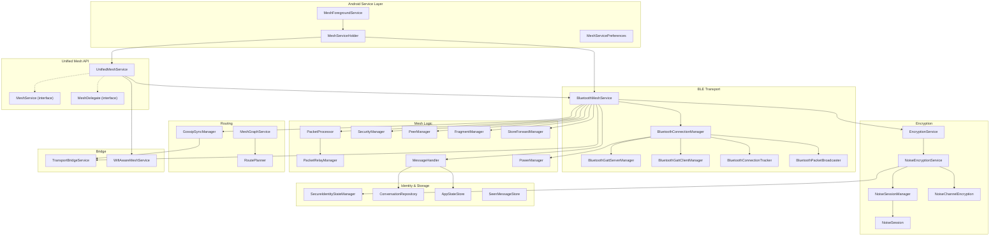

# BitChat Android — BLE Mesh Transport Architecture Analysis

> **Purpose**: Technical reference for extracting and adapting the BitChat BLE mesh
> transport layer into a standalone Volentify disaster-response application.
>
> **Scope**: Read-only analysis. No source code was modified.

---

## Table of Contents

1. [High-Level Architecture](#1-high-level-architecture)
2. [Package Map](#2-package-map)
3. [BLE Peer Discovery](#3-ble-peer-discovery)
4. [BLE Connection Creation](#4-ble-connection-creation)
5. [Incoming Message Reception](#5-incoming-message-reception)
6. [Outgoing Message Creation](#6-outgoing-message-creation)
7. [Routing & Relay](#7-routing--relay)
8. [TTL Handling](#8-ttl-handling)
9. [Deduplication](#9-deduplication)
10. [Message Persistence & Queuing](#10-message-persistence--queuing)
11. [Foreground Mesh Execution](#11-foreground-mesh-execution)
12. [Encryption Establishment (Noise Protocol)](#12-encryption-establishment-noise-protocol)
13. [Wire Protocol Format](#13-wire-protocol-format)
14. [Fragmentation](#14-fragmentation)
15. [Gossip Sync](#15-gossip-sync)
16. [Mesh Graph & Source Routing](#16-mesh-graph--source-routing)
17. [Transport Bridge (Multi-Transport)](#17-transport-bridge-multi-transport)
18. [Power Management](#18-power-management)
19. [Component Dependency Diagram](#19-component-dependency-diagram)

---

## 1. High-Level Architecture

BitChat's mesh layer follows a **component-coordinator** pattern. A single
coordinator class (`BluetoothMeshService` / `MeshCore`) instantiates and wires
several focused managers. Each manager owns a single concern (peers,
fragmentation, security, relay, store-and-forward, message processing) and
communicates through delegate interfaces.

```
┌──────────────────────────────────────────────────────────────┐
│                    MeshForegroundService                      │
│                   (Android FGS lifecycle)                     │
└───────────────────────────┬──────────────────────────────────┘
                            │ holds via MeshServiceHolder
┌───────────────────────────▼──────────────────────────────────┐
│               UnifiedMeshService (MeshService)               │
│      Feature-facing API — hides transport selection          │
└──────┬────────────────────────────────────────────┬──────────┘
       │                                            │
┌──────▼──────────────┐               ┌─────────────▼──────────┐
│ BluetoothMeshService│               │  WifiAwareMeshService  │
│   (BLE coordinator) │               │  (Wi-Fi Aware coord.)  │
└──────┬──────────────┘               └────────────────────────┘
       │ orchestrates
       ├── PeerManager
       ├── FragmentManager
       ├── SecurityManager
       ├── StoreForwardManager
       ├── MessageHandler
       ├── PacketProcessor  ──► PacketRelayManager
       ├── BluetoothConnectionManager
       │     ├── BluetoothGattServerManager  (advertise + peripheral)
       │     ├── BluetoothGattClientManager  (scan + central)
       │     ├── BluetoothConnectionTracker
       │     └── BluetoothPacketBroadcaster
       ├── EncryptionService ──► NoiseEncryptionService
       │                           └── NoiseSessionManager
       │                                  └── NoiseSession (per peer)
       └── GossipSyncManager
```

---

## 2. Package Map

| Package | Responsibility |
|---------|---------------|
| `mesh/` | BLE mesh transport: discovery, connections, GATT, broadcasting, fragmentation, relay, security, peer lifecycle, store-forward, power management |
| `service/` | Android foreground service lifecycle, notification, service holder singleton |
| `services/` | App-level state store, conversation persistence (SQLite), message routing (mesh ↔ Nostr), seen-message tracking, mesh graph, verification |
| `protocol/` | Binary wire format: `BitchatPacket`, `BinaryProtocol` encode/decode, `MessageType` enum, compression, padding |
| `noise/` | Noise Protocol XX handshake (Curve25519, ChaChaPoly, SHA-256), session manager, channel encryption |
| `crypto/` | High-level `EncryptionService` façade: wraps Noise, Ed25519 signing, identity fingerprinting |
| `identity/` | `SecureIdentityStateManager`: EncryptedSharedPreferences for static keys, signing keys, peer fingerprints |
| `model/` | Data classes: `BitchatMessage`, `RoutedPacket`, `FragmentPayload`, `IdentityAnnouncement`, `NoiseEncrypted`, `PeerCapabilities` |
| `sync/` | Gossip-based synchronization: GCS bloom filters, `REQUEST_SYNC` packet exchange |
| `wifi-aware/` | Wi-Fi Aware transport (parallel mesh over NAN) |
| `nostr/` | Nostr relay transport (internet bridge for offline peers) |
| `geohash/` | Location-based channel subscriptions |
| `net/` | Tor integration (Arti) |

---

## 3. BLE Peer Discovery

### Where it happens

| File | Class | Lines |
|------|-------|-------|
| `mesh/BluetoothGattClientManager.kt` | `BluetoothGattClientManager` | Scanning logic |
| `mesh/BluetoothGattServerManager.kt` | `BluetoothGattServerManager` | Advertising logic |

### How it works

**Scanning (Central / Client role)**:
- `BluetoothGattClientManager.start()` begins a BLE scan using the Android
  `BluetoothLeScanner` API.
- Scan filters match the BitChat service UUID defined in `AppConstants`.
- A `ScanCallback` fires for each discovered device. Duplicate MAC addresses are
  rate-limited and stale results trigger scan restarts via a watchdog coroutine.
- A duty-cycle job alternates between scan-on and scan-off windows driven by
  `PowerManager.BleSchedule`.
- Self-healing: if no scan results arrive within `SCAN_STALE_RESULT_MS`
  (120 s), the scanner is recycled automatically.

**Advertising (Peripheral / Server role)**:
- `BluetoothGattServerManager.start()` opens a GATT server and begins
  advertising using `BluetoothLeAdvertiser`.
- The advertise data includes the BitChat service UUID as a `ParcelUuid`.
- Advertise settings (power mode, connectable) are tuned by the current
  `PowerManager` profile.
- Self-healing: transient advertise failures trigger exponential-backoff retries
  (base 3 s, cap 30 s).

### Key methods

| Method | Purpose |
|--------|---------|
| `BluetoothGattClientManager.start()` | Begin scan duty cycle |
| `BluetoothGattClientManager.connectToDevice()` | Initiate GATT client connection to discovered device |
| `BluetoothGattServerManager.start()` | Start GATT server + BLE advertising |
| `BluetoothGattServerManager.setupGattServer()` | Create service, characteristic, register callbacks |

### Connection to next layer

On a successful scan result, the client manager calls `connectToDevice()`,
which flows into the **Connection Creation** layer (§4).

---

## 4. BLE Connection Creation

### Where it happens

| File | Class |
|------|-------|
| `mesh/BluetoothGattClientManager.kt` | `BluetoothGattClientManager` |
| `mesh/BluetoothGattServerManager.kt` | `BluetoothGattServerManager` |
| `mesh/BluetoothConnectionTracker.kt` | `BluetoothConnectionTracker` |
| `mesh/BluetoothConnectionManager.kt` | `BluetoothConnectionManager` |

### How it works

**Client-initiated (Central)**:
1. `BluetoothGattClientManager.connectToDevice(device, rssi)` calls
   `device.connectGatt()` with `TRANSPORT_LE`.
2. The GATT callback's `onConnectionStateChange` fires
   `STATE_CONNECTED` → service discovery (`gatt.discoverServices()`).
3. On service discovered, the client locates the BitChat characteristic by UUID,
   enables notifications via descriptor writes, then reports the connection
   to `BluetoothConnectionManagerDelegate.onDeviceConnected()`.

**Server-accepted (Peripheral)**:
1. An inbound connection triggers the GATT server callback's
   `onConnectionStateChange`.
2. The server manager assigns a per-connection `linkID` (UUID) and registers
   the device in `BluetoothConnectionTracker`.

**Tracking**:
- `BluetoothConnectionTracker` maintains a `ConcurrentHashMap<String, DeviceConnection>`
  keyed by device MAC address. Each entry records the GATT handle, characteristic,
  RSSI, link ID, and peer ID (once known via ANNOUNCE).
- `addressPeerMap: ConcurrentHashMap<String, String>` maps MAC → peer ID after
  the first ANNOUNCE packet is received on a link.
- Connection limits are enforced by `BluetoothConnectionManager.enforceStrictLimits()`,
  which evicts the weakest-RSSI connections when the cap (from `PowerManager`)
  is exceeded.

### Key methods

| Method | Purpose |
|--------|---------|
| `BluetoothGattClientManager.connectToDevice()` | Initiate GATT client connection |
| `BluetoothConnectionTracker.addDeviceConnection()` | Register new connection |
| `BluetoothConnectionTracker.observePeerIfCurrent()` | Bind peer ID to device link |
| `BluetoothConnectionManager.enforceStrictLimits()` | Cap active connections |

### Connection to next layer

Once a connection is live, the GATT characteristic write callback or
notification callback delivers raw bytes to
`BluetoothConnectionManagerDelegate.onPacketReceived()`, flowing into
**Incoming Message Reception** (§5).

---

## 5. Incoming Message Reception

### Where it happens

| File | Class | Responsibility |
|------|-------|---------------|
| `mesh/BluetoothConnectionManager.kt` | `BluetoothConnectionManager` | Receives raw BLE bytes, decodes `BitchatPacket` |
| `mesh/PacketProcessor.kt` | `PacketProcessor` | Per-peer serialized routing of decoded packets |
| `mesh/SecurityManager.kt` | `SecurityManager` | Signature verification, dedup, replay protection |
| `mesh/MessageHandler.kt` | `MessageHandler` | Type-specific message processing |

### Flow

```
GATT characteristic notification/write
  │
  ▼
BluetoothConnectionManagerDelegate.onPacketReceived(packet, peerID, device, linkID)
  │  ← BinaryProtocol.decode(bytes) already happened in GATT callback
  │
  ▼
BluetoothMeshService → PacketProcessor.processPacket(RoutedPacket)
  │
  ▼  (per-peer coroutine actor)
PacketProcessor.handleReceivedPacket(routed)
  │
  ├── SecurityManager.validatePacket()  → signature + dedup + replay
  │
  ├── Dispatch by MessageType:
  │     ANNOUNCE        → MessageHandler.handleAnnounce()
  │     MESSAGE         → MessageHandler.handleMessage()
  │     NOISE_HANDSHAKE → SecurityManager.handleNoiseHandshake()
  │     NOISE_ENCRYPTED → MessageHandler.handleNoiseEncrypted()
  │     FRAGMENT        → FragmentManager reassembly → recursive processPacket
  │     REQUEST_SYNC    → GossipSyncManager.handleIncomingSync()
  │     VOICE_FRAME     → Live voice pipeline
  │     FILE_TRANSFER   → File transfer pipeline
  │     LEAVE           → PeerManager.removePeer()
  │
  └── PacketRelayManager.handlePacketRelay()  → relay eligible packets (§7)
```

### Key methods

| Method | Purpose |
|--------|---------|
| `PacketProcessor.processPacket()` | Entry point; routes to per-peer actor |
| `PacketProcessor.handleReceivedPacket()` | Core protocol dispatch (mirrors iOS) |
| `SecurityManager.validatePacket()` | Signature verification, dedup, replay |
| `MessageHandler.handleNoiseEncrypted()` | Decrypt → parse NoisePayload → dispatch PM/ACK/read-receipt/verify |
| `MessageHandler.handleAnnounce()` | Parse `IdentityAnnouncement`, update PeerManager, initiate handshake |

### Connection to next layer

After `MessageHandler` processes a message, it calls
`delegate.onMessageReceived(BitchatMessage)` which propagates up to
`BluetoothMeshService` → `UnifiedMeshService` → `MeshDelegate` →
`AppStateStore` / UI.

---

## 6. Outgoing Message Creation

### Where it happens

| File | Class | Responsibility |
|------|-------|---------------|
| `mesh/MeshService.kt` | `MeshService` (interface) | Public API consumed by UI/routing |
| `mesh/UnifiedMeshService.kt` | `UnifiedMeshService` | Transport-agnostic facade |
| `mesh/BluetoothMeshService.kt` | `BluetoothMeshService` | BLE-specific send path |
| `services/MessageRouter.kt` | `MessageRouter` | Routes between mesh and Nostr |
| `protocol/BinaryProtocol.kt` | `BinaryProtocol` | Serialization to wire bytes |

### Flow (Private Message)

```
UI → MeshService.sendPrivateMessage(content, recipientPeerID, recipientNickname, messageID)
  │
  ▼
UnifiedMeshService delegates to BluetoothMeshService.sendPrivateMessage()
  │
  ├── Encrypt: EncryptionService.encryptForPeer() → Noise session encrypt
  │     ▸ Wraps content in PrivateMessagePacket TLV
  │     ▸ Wraps in NoisePayload(type=PRIVATE_MESSAGE)
  │     ▸ Noise ChaChaPoly encrypt with nonce
  │
  ├── Build BitchatPacket(type=NOISE_ENCRYPTED, senderID, recipientID, payload, ttl)
  │
  ├── Sign: EncryptionService.signPacket() → Ed25519 signature over packet-for-signing bytes
  │
  ├── Optionally add source route from RoutePlanner
  │
  ├── Fragment: FragmentManager.createFragments() if payload > 512 bytes
  │
  └── Broadcast: BluetoothConnectionManager.broadcastPacket(RoutedPacket)
        └── BluetoothPacketBroadcaster writes to all connected GATT links
```

### Flow (Broadcast Message)

```
MeshService.sendMessage(content, mentions, channel)
  │
  ├── If channel: encrypt payload with channel password via NoiseChannelEncryption
  │
  ├── Build BitchatPacket(type=MESSAGE, senderID, recipientID=BROADCAST, payload, ttl)
  │
  ├── Sign packet
  │
  ├── Register in GossipSyncManager for sync
  │
  └── Broadcast via BluetoothPacketBroadcaster + TransportBridgeService
```

### Key methods

| Method | Purpose |
|--------|---------|
| `BluetoothMeshService.sendPrivateMessage()` | Encrypt, build, sign, fragment, broadcast |
| `BluetoothMeshService.sendMessage()` | Build broadcast, sign, gossip-register, broadcast |
| `BluetoothMeshService.signPacketBeforeBroadcast()` | Ed25519 sign |
| `BluetoothPacketBroadcaster.broadcastPacket()` | Serialize and write to all GATT links |

---

## 7. Routing & Relay

### Where it happens

| File | Class | Responsibility |
|------|-------|---------------|
| `mesh/PacketRelayManager.kt` | `PacketRelayManager` | Centralized relay decision engine |
| `mesh/PacketProcessor.kt` | `PacketProcessor` | Invokes relay after local processing |
| `services/meshgraph/RoutePlanner.kt` | `RoutePlanner` | Dijkstra shortest-path for source routing |
| `services/meshgraph/MeshGraphService.kt` | `MeshGraphService` | Gossip-built topology graph |

### Relay decision flow

```
PacketProcessor.handleReceivedPacket()
  │  (after local processing succeeds and packet is valid)
  ▼
PacketRelayManager.handlePacketRelay(routed)
  │
  ├── Skip if addressed to us
  ├── Skip if from ourselves
  ├── Check TTL: if 0, drop
  ├── Decrement TTL by 1
  │
  ├── Source route check:
  │     If packet.route contains our peerID,
  │     find next hop and try sendToPeer() for directed forwarding.
  │     Fall back to broadcast if next hop is not directly connected.
  │
  └── Probabilistic broadcast relay:
        shouldRelayPacket() considers:
        ├── High TTL (≥4): always relay
        ├── Small network (≤3 peers): always relay
        └── Adaptive probability based on network size:
              ≤10 → 100%, ≤30 → 85%, ≤50 → 70%, ≤100 → 55%, >100 → 40%
```

### Source routing

- `MeshGraphService` builds a topology graph from verified ANNOUNCE packets
  that include a neighbor list TLV (gossip-based).
- `RoutePlanner.shortestPath(src, dst)` uses Dijkstra on confirmed (bidirectional)
  edges to compute a full path.
- The sender inserts the intermediate hops into `BitchatPacket.route` as a
  list of 8-byte peer IDs.
- At each intermediate node, `PacketRelayManager` finds its own position in the
  route and forwards to the next hop.

### Key methods

| Method | Purpose |
|--------|---------|
| `PacketRelayManager.handlePacketRelay()` | Main relay entry point |
| `PacketRelayManager.shouldRelayPacket()` | Probabilistic relay decision |
| `PacketRelayManager.isPacketAddressedToMe()` | Recipient check |
| `RoutePlanner.shortestPath()` | Dijkstra path computation |
| `MeshGraphService.updateFromAnnouncement()` | Ingest neighbor gossip |

---

## 8. TTL Handling

### Where it happens

| File | Class | Lines |
|------|-------|-------|
| `mesh/PacketRelayManager.kt` | `PacketRelayManager` | `handlePacketRelay()` |

### Mechanism

- **Default TTL**: Set in `AppConstants.MESSAGE_TTL_HOPS` (referenced as `MAX_TTL`
  in `BluetoothMeshService`). Used for all outgoing packets.
- **Check**: `if (packet.ttl == 0u.toUByte()) { … not relaying … return }`
- **Decrement**: `val decrementedTtl = (packet.ttl - 1u).toUByte()`
- **Voice frame cap**: For `VOICE_FRAME` in networks > 6 peers, TTL is further
  capped to 5 to limit voice flooding.
- **Signing exclusion**: TTL is explicitly excluded from the signature preimage
  (`toBinaryDataForSigning()` zeros TTL) because TTL changes at every hop.

---

## 9. Deduplication

### Where it happens

| File | Class | Responsibility |
|------|-------|---------------|
| `mesh/SecurityManager.kt` | `SecurityManager` | In-memory message-ID set + timestamp expiry |
| `service/TransportBridgeService.kt` | `TransportBridgeService` | Cross-transport packet dedup |
| `sync/GCSFilter.kt` | `GCSFilter` | Golomb-Coded-Set bloom filter for gossip sync |

### SecurityManager dedup

- **ID generation**: `generateMessageID(packet, peerID)` combines sender, type,
  timestamp, and payload hash into a unique string.
- **Storage**: `processedMessages: Set<String>` (synchronized) with
  `messageTimestamps: Map<String, Long>` for expiry.
- **Timeout**: Messages older than `MESSAGE_TIMEOUT` (5 minutes) are pruned
  every `CLEANUP_INTERVAL` (5 minutes).
- **Capacity**: Capped at `MAX_PROCESSED_MESSAGES`.
- **ANNOUNCE exception**: A max-TTL ANNOUNCE (fresh direct neighbor) bypasses
  dedup to ensure re-observation on a new transport link.
- **Ordering**: Signature verification runs *before* recording to prevent
  attacker-controlled invalid packets from poisoning the dedup cache.

### TransportBridgeService dedup

- `seenPackets: LinkedHashMap<String, Long>` (LRU, max 4096 entries).
- Keyed by SHA-256 digest of packet bytes. TTL 5 minutes.
- Prevents loops when the same packet arrives on both BLE and Wi-Fi Aware.

---

## 10. Message Persistence & Queuing

### Where it happens

| File | Class | Responsibility |
|------|-------|---------------|
| `mesh/StoreForwardManager.kt` | `StoreForwardManager` | In-memory packet cache for offline peers |
| `services/ConversationRepository.kt` | `ConversationRepository` | SQLite persistence for private conversations |
| `services/AppStateStore.kt` | `AppStateStore` | Process-wide in-memory state (StateFlows) |
| `services/SeenMessageStore.kt` | `SeenMessageStore` | Persistent delivered/read/receipt tracking |
| `services/MessageRouter.kt` | `MessageRouter` | Outbox queue for messages awaiting Noise sessions |

### Store-and-forward (mesh relay cache)

- `StoreForwardManager` caches packets in-memory for peers that are currently
  offline.
- **Regular cache**: Up to `MAX_CACHED_MESSAGES`, TTL `MESSAGE_CACHE_TIMEOUT`
  (12 hours).
- **Favorite queue**: Per-peer queues with higher capacity
  `MAX_CACHED_MESSAGES_FAVORITES`.
- On peer reconnection (after Noise handshake),
  `sendCachedMessages(peerID)` drains the queue with 10 ms inter-message delay.
- Skips caching for ANNOUNCE, LEAVE, handshake, and broadcast packets.

### Conversation persistence (SQLite)

- `ConversationRepository` uses a single-writer `CoroutineDispatcher` over
  `SQLiteOpenHelper`.
- Private messages are stored encrypted using `ConversationStorageCipher`.
- `AppStateStore` maintains `StateFlow<Map<String, List<BitchatMessage>>>` for
  private messages and `StateFlow<List<BitchatMessage>>` for public messages.
- `SeenMessageStore` persists delivered/read/receipt-sent IDs in
  `EncryptedSharedPreferences` with a cap of `SEEN_MESSAGE_MAX_IDS`.

### MessageRouter outbox

- `MessageRouter` queues private messages when no Noise session is established.
- Outbox is drained periodically (`OUTBOX_TICK_MS`) and on session establishment.
- Messages expire after `OUTBOX_MESSAGE_TTL_MS`, capped at `OUTBOX_MAX_PER_PEER`.
- Handshake retries use exponential backoff.

### Key methods

| Method | Purpose |
|--------|---------|
| `StoreForwardManager.cacheMessage()` | Cache packet for offline peer |
| `StoreForwardManager.sendCachedMessages()` | Drain cache on peer reconnect |
| `ConversationRepository.insertMessage()` | SQLite insert |
| `AppStateStore.addPrivateMessage()` | In-memory state update |
| `MessageRouter.route()` | Decide mesh vs Nostr vs queue |

---

## 11. Foreground Mesh Execution

### Where it happens

| File | Class | Responsibility |
|------|-------|---------------|
| `service/MeshForegroundService.kt` | `MeshForegroundService` | Android foreground service |
| `service/MeshServiceHolder.kt` | `MeshServiceHolder` | Process-wide singleton holder |
| `service/MeshServicePreferences.kt` | `MeshServicePreferences` | Background-enabled preference |
| `service/BootCompletedReceiver.kt` | `BootCompletedReceiver` | Auto-start after boot |
| `service/AppShutdownCoordinator.kt` | `AppShutdownCoordinator` | Graceful shutdown |
| `mesh/PowerManager.kt` | `PowerManager` | Battery/foreground-aware scheduling |

### Lifecycle

```
App launch / Boot
  │
  ▼
MeshForegroundService.start(context)
  ├── Checks: background enabled? BT permissions granted?
  ├── API ≥ 26: startForegroundService()
  └── API < 26: startService()
        │
        ▼
    onCreate()
      ├── Create notification channel
      ├── MeshServiceHolder.getOrCreate(context) → BluetoothMeshService singleton
      ├── MeshServiceHolder.getUnifiedOrCreate() → UnifiedMeshService
      └── PeerAvailabilityNotifier setup
        │
        ▼
    onStartCommand(ACTION_START)
      ├── startForeground(NOTIFICATION_ID, notification, CONNECTED_DEVICE)
      ├── UnifiedMeshService.startServices()
      │     ├── BluetoothMeshService.startServices()
      │     │     ├── BluetoothConnectionManager.start()
      │     │     │     ├── BluetoothGattServerManager.start()  (advertise)
      │     │     │     ├── BluetoothGattClientManager.start()  (scan)
      │     │     │     └── BluetoothConnectionTracker.start()
      │     │     ├── GossipSyncManager.start()
      │     │     └── Send initial ANNOUNCE broadcast
      │     └── WifiAwareController.startIfPossible()
      └── Start notification update observer
```

### Key methods

| Method | Purpose |
|--------|---------|
| `MeshForegroundService.start()` | Static entry point |
| `MeshForegroundService.stop()` | Sends ACTION_STOP |
| `MeshServiceHolder.getOrCreate()` | Singleton with reusability check |
| `PowerManager.getInstance()` | Singleton, observes ProcessLifecycleOwner |

### PowerManager profiles

| Profile | Trigger | Scan duty | Max connections |
|---------|---------|-----------|----------------|
| PERFORMANCE | Foreground + charging | Continuous | 8 |
| BALANCED | Foreground + battery | Duty-cycled | 6 |
| POWER_SAVER | Background | Reduced duty | 4 |
| ULTRA_LOW_POWER | Background + low battery | Minimal | 2 |

---

## 12. Encryption Establishment (Noise Protocol)

### Where it happens

| File | Class | Responsibility |
|------|-------|---------------|
| `crypto/EncryptionService.kt` | `EncryptionService` | High-level API: sign, encrypt, decrypt, identity |
| `noise/NoiseEncryptionService.kt` | `NoiseEncryptionService` | Noise protocol wrapper: keys, sessions, channels |
| `noise/NoiseSessionManager.kt` | `NoiseSessionManager` | Per-peer session lifecycle |
| `noise/NoiseSession.kt` | `NoiseSession` | Single XX handshake state machine |
| `noise/NoiseChannelEncryption.kt` | `NoiseChannelEncryption` | Password-derived channel encryption |
| `identity/SecureIdentityStateManager.kt` | `SecureIdentityStateManager` | EncryptedSharedPreferences for keys |

### Protocol

- **Pattern**: `Noise_XX_25519_ChaChaPoly_SHA256`
- **3-message XX handshake**:
  1. `→ e` (32 bytes — ephemeral key)
  2. `← e, ee, s, es` (96 bytes — ephemeral + static exchange)
  3. `→ s, se` (48 bytes — encrypted static key)
- After handshake: transport mode with ChaChaPoly AEAD encryption.
- **Replay protection**: 4-byte nonce prefix on every ciphertext, 1024-bit
  sliding window.
- **Rekeying**: After 1 hour (`REKEY_TIME_LIMIT_MS`) or 10 K messages
  (`REKEY_MESSAGE_LIMIT_SESSION`), a new handshake is initiated.

### Key lifecycle

```
App first launch
  │
  ▼
SecureIdentityStateManager.loadStaticKey()
  ├── Found: load Curve25519 key pair from EncryptedSharedPreferences
  └── Not found: generate new key pair, persist
        │
        ▼
Peer ID = SHA-256(staticPublicKey).hex().take(16)
  │
  ▼
NoiseSessionManager created with local static keys
  │
  ▼
On ANNOUNCE received from new peer:
  BluetoothMeshService.handleAnnounce()
    → SecurityManager.initiateHandshakeIfNeeded()
      → NoiseSessionManager.createSession(peerID, isInitiator=true)
        → NoiseSession: generate ephemeral key, send Message 1
          │
          ▼
        Peer responds: Message 2 received
          → NoiseSession processes, sends Message 3
            │
            ▼
          Session established → onSessionEstablished callback
            → SecurityManager.onKeyExchangeCompleted()
              → Authenticated session token recorded
              → StoreForwardManager.sendCachedMessages()
```

### Ed25519 signing (separate from Noise)

- `EncryptionService` maintains an Ed25519 key pair (BouncyCastle) persisted
  in `EncryptedSharedPreferences`.
- Every outgoing packet is signed: `signPacketBeforeBroadcast()` computes
  Ed25519 over `toBinaryDataForSigning()` (TTL zeroed, signature excluded).
- Verification: `SecurityManager.verifyPacketSignature()` checks Ed25519
  signature against the peer's signing key learned from ANNOUNCE.

### Key methods

| Method | Purpose |
|--------|---------|
| `EncryptionService.encryptForPeer()` | Noise encrypt payload for specific peer |
| `EncryptionService.decryptFromPeer()` | Noise decrypt |
| `EncryptionService.signPacket()` | Ed25519 sign |
| `EncryptionService.verifySignature()` | Ed25519 verify |
| `NoiseSessionManager.processHandshake()` | Handle incoming handshake message |
| `NoiseSession.startHandshake()` | Generate and return Message 1 |
| `NoiseSession.processMessage()` | Process incoming handshake message, advance state |

---

## 13. Wire Protocol Format

### Where it happens

| File | Class |
|------|-------|
| `protocol/BinaryProtocol.kt` | `BinaryProtocol` (encode/decode), `BitchatPacket` (data class) |
| `protocol/MessagePadding.kt` | `MessagePadding` (padding/unpadding) |
| `protocol/CompressionUtil.kt` | `CompressionUtil` (DEFLATE compression) |

### Packet structure

```
┌──────────────────────────────────────────────────────────────┐
│ Header (14 bytes v1 / 16 bytes v2)                           │
│ ┌─────────┬──────┬─────┬───────────┬───────┬──────────────┐ │
│ │ Version │ Type │ TTL │ Timestamp │ Flags │ PayloadLen   │ │
│ │ 1 byte  │ 1 b  │ 1 b │ 8 bytes   │ 1 b   │ 2b(v1)/4b(v2)│
│ └─────────┴──────┴─────┴───────────┴───────┴──────────────┘ │
├──────────────────────────────────────────────────────────────┤
│ SenderID: 8 bytes (fixed)                                    │
├──────────────────────────────────────────────────────────────┤
│ RecipientID: 8 bytes (if flags.hasRecipient)                 │
├──────────────────────────────────────────────────────────────┤
│ Route: 1 byte count + N × 8 bytes (v2 only, if present)     │
├──────────────────────────────────────────────────────────────┤
│ Payload: variable (may be DEFLATE compressed)                │
├──────────────────────────────────────────────────────────────┤
│ Signature: 64 bytes (if flags.hasSignature) — Ed25519        │
├──────────────────────────────────────────────────────────────┤
│ Padding: PKCS#7-style to next 16-byte block                  │
└──────────────────────────────────────────────────────────────┘
```

### Flags byte

| Bit | Meaning |
|-----|---------|
| 0   | hasRecipient |
| 1   | hasSignature |
| 2   | isCompressed |

### MessageType enum

| Type | Value | Description |
|------|-------|-------------|
| ANNOUNCE | 0x01 | Peer identity broadcast |
| MESSAGE | 0x02 | User message (public or private) |
| LEAVE | 0x03 | Peer departure notification |
| NOISE_HANDSHAKE | 0x10 | Noise XX handshake message |
| NOISE_ENCRYPTED | 0x11 | Encrypted transport payload |
| FRAGMENT | 0x20 | Fragment of a larger packet |
| REQUEST_SYNC | 0x21 | Gossip sync request with GCS filter |
| FILE_TRANSFER | 0x22 | File/media transfer |
| VOICE_FRAME | 0x29 | Ephemeral push-to-talk voice |

---

## 14. Fragmentation

### Where it happens

| File | Class |
|------|-------|
| `mesh/FragmentManager.kt` | `FragmentManager` |
| `mesh/FragmentingPacketSender.kt` | `FragmentingPacketSender` |
| `model/FragmentPayload.kt` | `FragmentPayload` |

### Mechanism

- **Threshold**: Packets > 512 bytes are fragmented.
- **Fragment header**: 13 bytes (fragment ID 8 bytes, index 2 bytes, total 2 bytes,
  original type 1 byte).
- **Max fragment data**: Dynamically calculated: `512 - packet overhead`.
  Default ≈ 469 bytes.
- **Reassembly**: `incomingFragments: ConcurrentHashMap<fragmentID, Map<index, data>>`.
  When all fragments arrive, the original packet is reconstructed and re-processed
  through `PacketProcessor.handleReceivedPacket()`.
- **Timeout**: Incomplete fragment sets are cleaned up after 30 seconds.
- **Global memory cap**: Tracked by `globalBufferedBytes` to prevent OOM from
  fragment flooding.

---

## 15. Gossip Sync

### Where it happens

| File | Class |
|------|-------|
| `sync/GossipSyncManager.kt` | `GossipSyncManager` |
| `sync/GCSFilter.kt` | `GCSFilter` (Golomb-Coded Set) |
| `sync/PacketIdUtil.kt` | `PacketIdUtil` |
| `model/RequestSyncPacket.kt` | `RequestSyncPacket` |

### Mechanism

- Every 30 seconds, `sendRequestSync()` constructs a GCS bloom filter of all
  packet IDs this node has seen.
- The filter is broadcast as a `REQUEST_SYNC` packet (TTL = 1, single hop).
- Recipients decode the GCS, find packets they hold that the requester is
  missing, and re-broadcast those packets.
- `GossipSyncManager` stores:
  - `messages: LinkedHashMap` — broadcast messages (capped by `seenCapacity()`).
  - `latestAnnouncementByPeer: ConcurrentHashMap` — one ANNOUNCE per peer.
- Stale announcements are pruned periodically.

---

## 16. Mesh Graph & Source Routing

### Where it happens

| File | Class |
|------|-------|
| `services/meshgraph/MeshGraphService.kt` | `MeshGraphService` |
| `services/meshgraph/RoutePlanner.kt` | `RoutePlanner` |
| `services/meshgraph/GossipTLV.kt` | `GossipTLV` |

### How it works

- ANNOUNCE packets include a neighbor-list TLV: up to 10 direct peer IDs.
- `MeshGraphService.updateFromAnnouncement()` ingests neighbor sets, building
  an adjacency graph. Edges can be unidirectional (one peer claims the other)
  or confirmed (bidirectional).
- `RoutePlanner.shortestPath(src, dst)` runs Dijkstra over confirmed edges
  to find the shortest multi-hop path.
- The sender stamps intermediate hops into `BitchatPacket.route`.
- `PacketRelayManager` at each intermediate node reads the route list, finds
  its own position, and sends directly to the next hop peer. Falls back to
  broadcast if the next hop is not directly connected.

---

## 17. Transport Bridge (Multi-Transport)

### Where it happens

| File | Class |
|------|-------|
| `service/TransportBridgeService.kt` | `TransportBridgeService` |

### How it works

- Singleton bridge with a `ConcurrentHashMap<String, TransportLayer>` registry.
- Each transport (BLE, Wi-Fi Aware) registers via `TransportBridgeService.register(id, layer)`.
- When BLE receives a packet it calls `TransportBridgeService.broadcast("BLE", routed)`,
  which forwards to all *other* registered transports.
- Cross-transport dedup uses a SHA-256 LRU set (`seenPackets`, max 4096, TTL 5 min).
- `TransportLayer` interface requires: `send(RoutedPacket)`, `sendAndReport(RoutedPacket)`,
  `sendToPeer(peerID, packet)`.

---

## 18. Power Management

### Where it happens

| File | Class |
|------|-------|
| `mesh/PowerManager.kt` | `PowerManager` |

### How it works

- Singleton, observes `ProcessLifecycleOwner` for foreground/background state
  and `BatteryManager` for charge level.
- Exposes `StateFlow<PowerProfile>` that includes `BleSchedule` (scan on/off
  windows, max connections) and `WifiAwareSchedule`.
- Consumers (`BluetoothGattClientManager`, `BluetoothGattServerManager`,
  `BluetoothConnectionManager`) observe the profile and adjust scan duty cycles,
  advertise power, and connection limits accordingly.

---

## 19. Component Dependency Diagram



---

## Summary of Key Entry Points for Volentify Extraction

| Concern | Primary file(s) | Key class(es) |
|---------|-----------------|---------------|
| **Start mesh** | `service/MeshForegroundService.kt`, `service/MeshServiceHolder.kt` | `MeshForegroundService`, `MeshServiceHolder` |
| **BLE scan + advertise** | `mesh/BluetoothGattClientManager.kt`, `mesh/BluetoothGattServerManager.kt` | `BluetoothGattClientManager`, `BluetoothGattServerManager` |
| **Connection tracking** | `mesh/BluetoothConnectionTracker.kt`, `mesh/BluetoothConnectionManager.kt` | `BluetoothConnectionTracker`, `BluetoothConnectionManager` |
| **Packet send** | `mesh/BluetoothPacketBroadcaster.kt` | `BluetoothPacketBroadcaster` |
| **Packet receive + dispatch** | `mesh/PacketProcessor.kt` | `PacketProcessor` |
| **Relay / routing** | `mesh/PacketRelayManager.kt`, `services/meshgraph/RoutePlanner.kt` | `PacketRelayManager`, `RoutePlanner` |
| **Security (dedup, sig, replay)** | `mesh/SecurityManager.kt` | `SecurityManager` |
| **Noise encryption** | `crypto/EncryptionService.kt`, `noise/*` | `EncryptionService`, `NoiseEncryptionService`, `NoiseSessionManager`, `NoiseSession` |
| **Identity persistence** | `identity/SecureIdentityStateManager.kt` | `SecureIdentityStateManager` |
| **Fragmentation** | `mesh/FragmentManager.kt` | `FragmentManager` |
| **Store-and-forward** | `mesh/StoreForwardManager.kt` | `StoreForwardManager` |
| **Message persistence** | `services/ConversationRepository.kt`, `services/AppStateStore.kt` | `ConversationRepository`, `AppStateStore` |
| **Wire protocol** | `protocol/BinaryProtocol.kt` | `BinaryProtocol`, `BitchatPacket` |
| **Gossip sync** | `sync/GossipSyncManager.kt` | `GossipSyncManager` |
| **Power management** | `mesh/PowerManager.kt` | `PowerManager` |
| **Multi-transport bridge** | `service/TransportBridgeService.kt` | `TransportBridgeService` |
